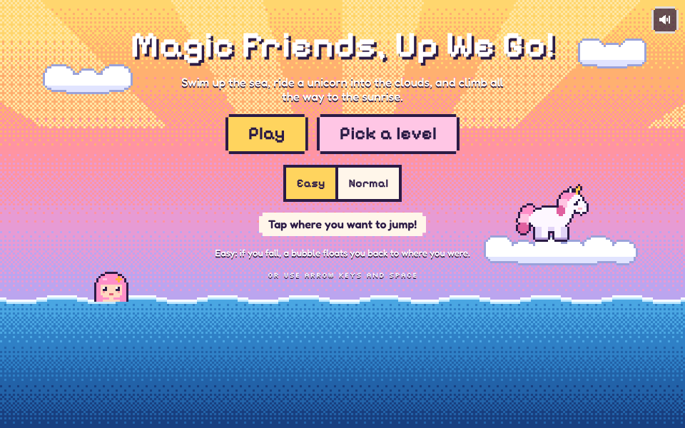
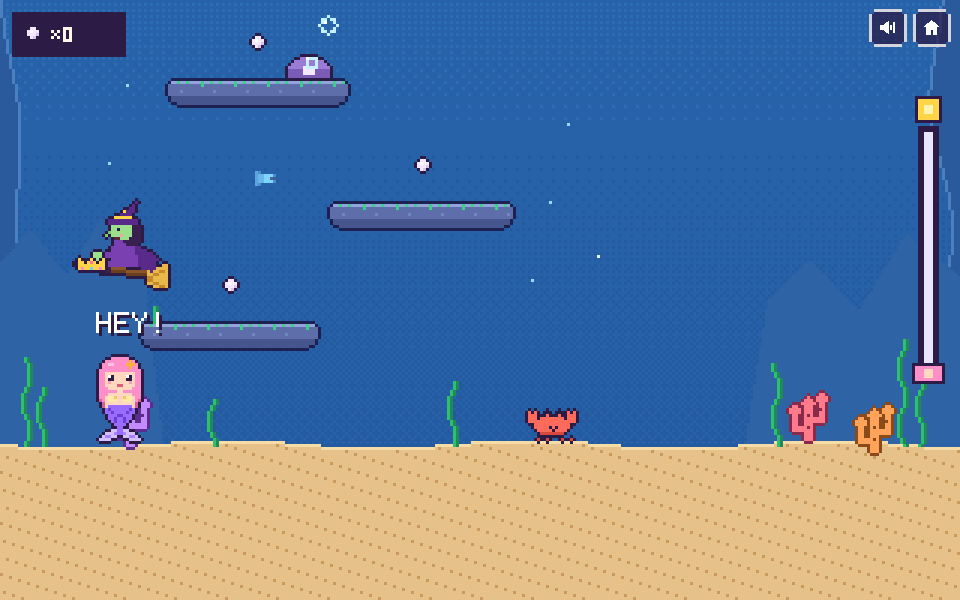
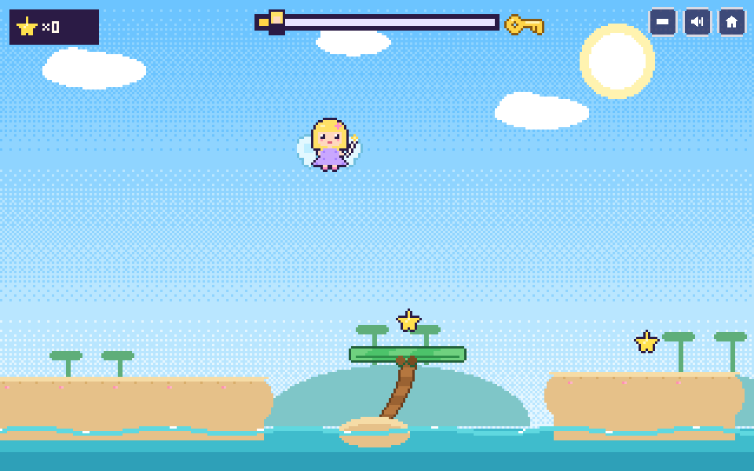
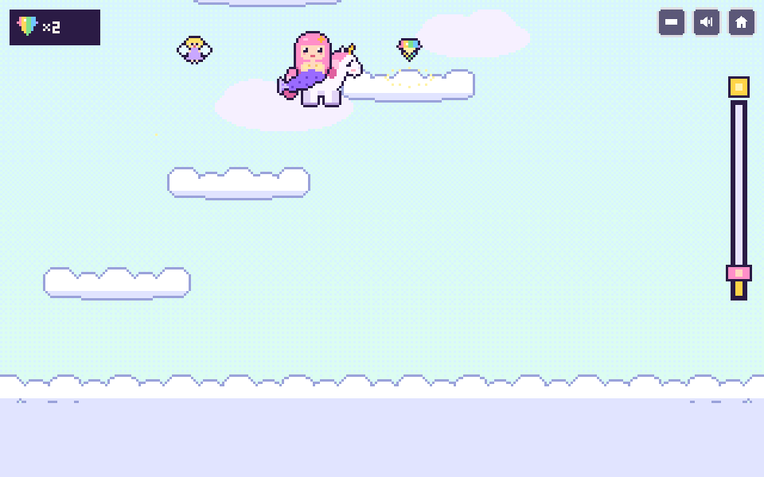
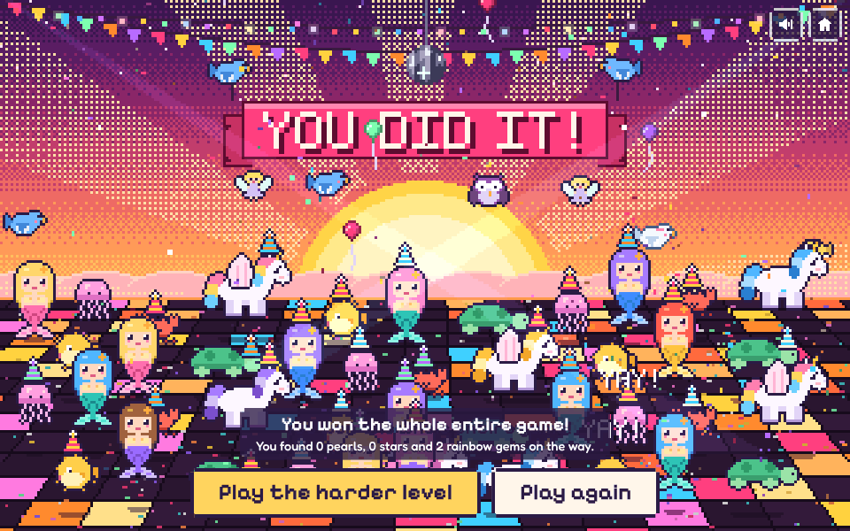

# Magic Friends, Up We Go!

A pixel-art climbing game for little kids. A mermaid, a fairy and a unicorn outsmart a grumpy witch across 60 levels and 12 worlds to bring back the sunrise.

**[▶ Play it now](https://jwildfire.github.io/magic-friends/)**. It works in any modern browser on a phone, tablet or computer. Nothing to install.

It was designed with a five-year-old co-designer, who came up with the mermaid, the unicorn, the sunrise and the witch.

## The story

| Under the sea | Fairy Island | Up in the sky |
| --- | --- | --- |
|  |  |  |
| The witch steals the mermaid's magic crown. Swim up through four ocean worlds to get it back. | The witch locks the unicorn in a cage. The fairy flutters through palm trees and treetops to find the key and set her free. | The witch steals the sunbeams. The friends ride the unicorn from cloud to cloud, all the way up to the sunrise. |

Every world ends with a victory parade. Reaching the sunrise starts a big dance party, and unlocks a harder version of the game.

## How to play

- **Tap or click where you want to jump.** Your friend hops there on their own.
- **Keyboard:** arrow keys or A/D to move, and Space, Up, W, Z or X to jump.
- **Touch buttons:** the button in the top corner shows a left, right and jump pad.

Pick a mode on the title screen:

| Mode | What it's like |
| --- | --- |
| Easy | If you fall, a bubble floats you back to the last ledge or cloud you stood on. |
| Normal | If you fall, a bubble carries you back to the last checkpoint. |
| Harder | Unlocks after you reach the sunrise. Fewer checkpoints, faster critters, extra critters, and clouds that puff away a moment after you land on them. Win it to earn a golden crown. |

Progress saves in your browser, so you can stop and come back later.

## The worlds

1. Deep Blue Sea
2. Sunken Treasure Ship
3. Coral Reef
4. Sparkle Lagoon
5. Palm Tree Island
6. Fairy Treetops
7. Cloud Hop
8. Candy Clouds
9. Giant Flower Vine
10. Rainbow Bridges
11. Snowflake Sky
12. Starry Night

Each world has five levels. Worlds 1 to 4 and 7 to 12 climb straight up. Worlds 5 and 6 scroll sideways.

## Working on the game

The whole game is one file, `index.html`, with no libraries and no build tools. All the art is drawn in code, and all the sounds and music are made with the Web Audio API. To play it offline, download `index.html` (or `magic-friends.html` from the [latest release](https://github.com/jwildfire/magic-friends/releases/latest)) and open it in a browser.

The source is split into pieces in `src/`, and `./build.sh` joins them back into `index.html`:

| File | What's in it |
| --- | --- |
| `src/head.html` | Page title, fonts and styles |
| `src/body.html` | Menus and buttons, plus the character choices |
| `src/sprites.js` | The pixel drawing helpers, the characters and the sound effects |
| `src/world.js` | Themes, the 12 worlds, and the level generator |
| `src/play.js` | Jumping, tap-to-jump, rescue bubbles and saving |
| `src/scenes.js` | The title screen and story cartoons |
| `src/party.js` | The world victory parades and the sunrise party |
| `src/island.js` | Fairy Island levels, the witch, and the story scenes |
| `src/tail.js` | Menus, input, screen sizing and the game loop |

After you edit anything in `src/`, run `./build.sh` and commit both the source and `index.html`. Every push to `main` republishes the game to GitHub Pages. To make a new release, update `RELEASE_NOTES.md`, then run the **Release** workflow from the Actions tab with a version like `v1.1` (pushing a tag like `v1.1` works too).

Add `?test` to the URL to get a `window.__game` object for testing in the browser console.

## Credits

The sunrise party is modeled on "Orange Party", the closing slide of Jeremy Wildfire's R/Pharma 2026 keynote. That slide is adapted from ["Kākāpō Party"](https://tools.simonwillison.net/kakapo-party) by Simon Willison (Apache License 2.0). The party code here is written fresh for this game.

Fonts are [Fredoka](https://fonts.google.com/specimen/Fredoka), [Pixelify Sans](https://fonts.google.com/specimen/Pixelify+Sans) and [Silkscreen](https://fonts.google.com/specimen/Silkscreen), loaded from Google Fonts under the SIL Open Font License.

## License

[MIT](LICENSE)

## jeremy.v2: Bigger buttons and a pause

Update idea from Jeremy (game idea #225), word for word:

> Make Magic Friends, Up We Go! comfortable on a phone and with a keyboard, so it meets the phone bar from the phone-friendly games task (jwildfire/gameon#187): every button at least 48 x 48 px at 375 px wide, 8 px clear of each other and the screen edges, and both WASD and the arrow keys working. Measured on jeremy.v1 on 2026-10-29:
>
> - The corner buttons (arrow pad, Sound, Home) are 38 x 38, 6 px apart and 6 px from the right edge.
> - Easy and Normal are 64 x 44 and 79 x 44, only 4 px apart. The level-picker number buttons are 29 x 30 with 3 px gaps.
> - There's no pause, and P and Escape do nothing. Sound, Home and the arrow-pad toggle have no keys.
>
> Make the corner buttons 48 x 48 with 8 px gaps and 8 px from the edge, make Easy, Normal and the level buttons at least 48 px with 8 px gaps (two rows if needed), and add a pause on P or Escape plus keys for Sound and Home. Walking and jumping with WASD or the arrows already passes. Keep everything else the same.
>
> This game also lives in jwildfire/magic-friends. Making the same fix there too means the next import from that repo won't bring the old controls back.

Started from jeremy.v1. The corner buttons are 48 x 48 px, 8 px apart and 8 px from the edge, and sit beside the game when there's room (above it on a phone held upright, to its right held sideways), so in play they cover less of it than before. In play the corner is one Pause button; Sound, the arrow buttons and the start screen are in the pause card. Easy, Normal and Harder are 48 px tall and 9 px apart. Each world's card in Pick a level is now one big button that opens that world's five levels as 56 px buttons. P or Escape pauses, M is Sound, H is the start screen, B shows or hides the arrow buttons, and the arrows or WASD move between buttons in the menus. Saves are the same as jeremy.v1's.
